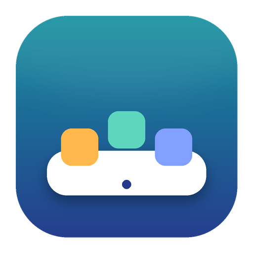
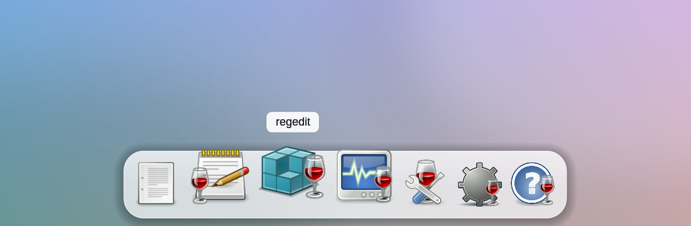
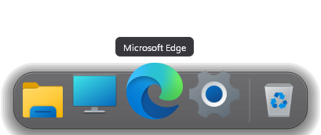
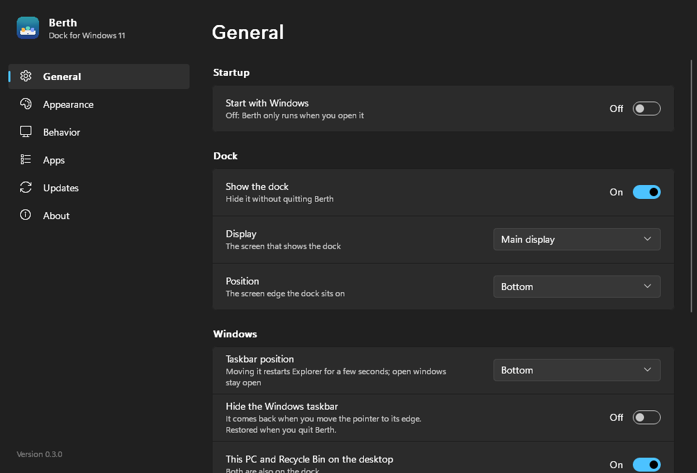
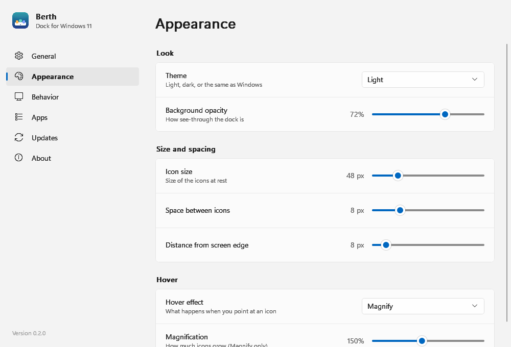
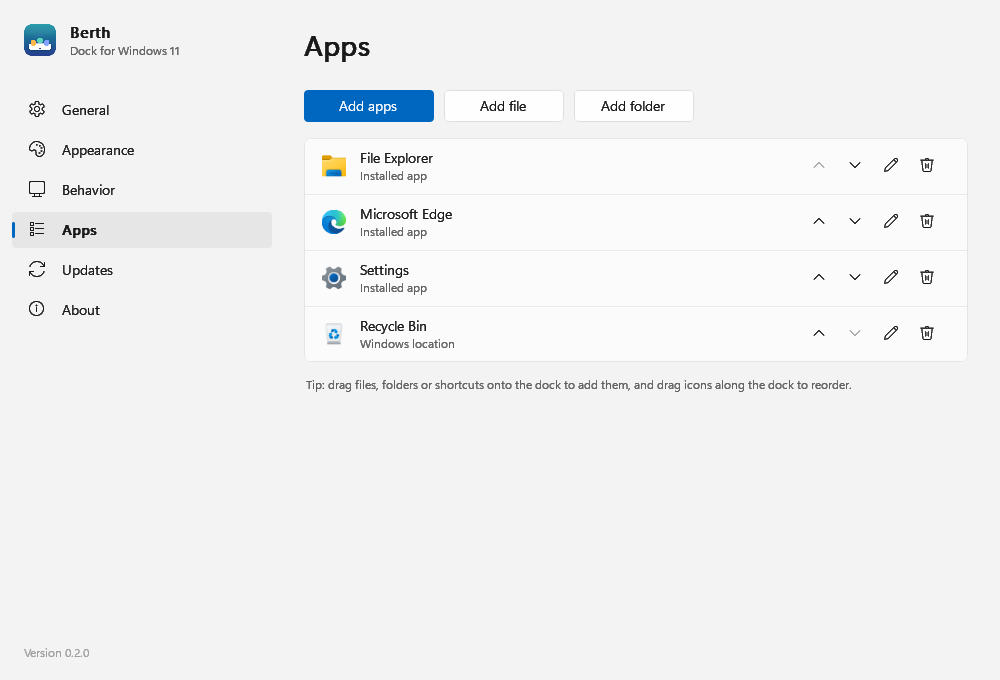
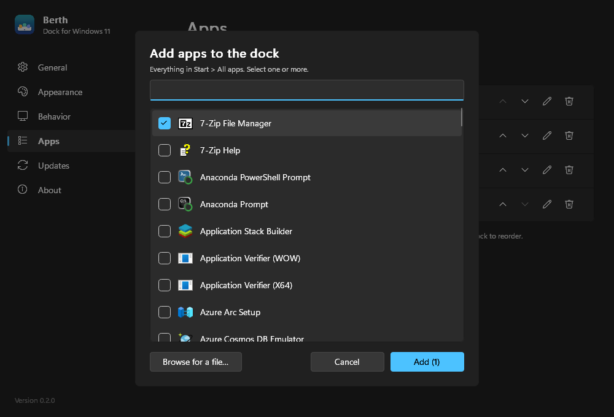
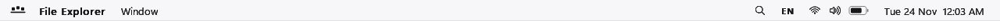
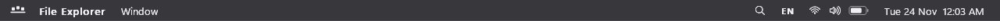
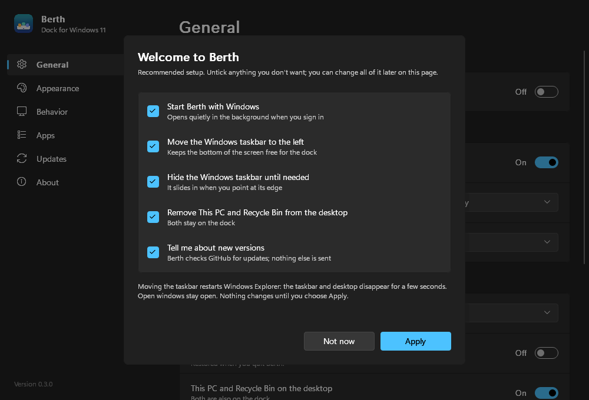

<p align="center">
  
</p>

<h1 align="center">Berth</h1>

<p align="center">A lightweight, Mac-style dock for Windows 11. Free, open source, and offline unless you check for updates.</p>

---

Berth adds a clean, centered row of app icons near the edge of your screen, with a soft
translucent panel, smooth hover magnification and dots under the apps that are running. It
sits next to the Windows taskbar instead of replacing it (or, if you like, tucks the
taskbar away until you need it), and you control all of it from a dashboard.




> **About these screenshots:** they're rendered by Berth itself on Windows (Server 2025, the
> Windows 11 24H2 code base) in the automated build. The dock images are placed on a
> sample background and enlarged 2×; the dashboard images are shown as drawn.

## Features

- **Dock:** a centered row of icons that stays above normal windows, on the bottom, left
  or right edge of the screen you choose.
- **Pin and launch apps:** add apps from a list of everything in Start > All apps
  (including Microsoft Store apps), browse for any program, shortcut, file or folder, or
  drag files onto the dock. Drag icons to reorder them.
- **Window previews:** rest the pointer on an open app to see a live thumbnail of each of
  its windows. Click one to switch to it, or use its close button (or middle-click) to close it.
- **Menu bar (optional):** a Mac-style bar along the top of the screen. On the left: a
  Berth menu (Windows Settings, Task Manager, Sleep, Restart, Shut Down, Lock, Sign Out),
  the name of the app you're using with Hide, Hide Others, Show All and Quit, and a Window
  menu (Minimize, Zoom, Close). On the right: search, your input language (when you have
  more than one), Wi-Fi, volume and battery (click for Quick Settings), and the date and
  time (click for notifications). Windows keeps maximized windows below it. Turn it on in
  **Dashboard > Appearance > Menu bar** or in the Recommended setup.
- **Mac-style window animations (optional):** windows shrink into their app's dock icon
  when you minimize them and grow back out when you click the icon, and apps opened from
  the dock zoom out of their icon. Turn it on in **Dashboard > Behavior**. While it's on,
  Berth switches off Windows' own minimize/maximize animation for the current sign-in only
  (so the two don't play at once) and switches it back on when you turn the option off or
  quit Berth.
- **Mac-style touches:** drag an icon off the dock to remove it, the Recycle Bin sits at
  the end after a divider (drop files on it to delete them), and an app's icon bounces
  when one of its windows needs your attention.
- **Starts with your taskbar apps:** a new dock starts with the apps pinned to your
  Windows taskbar, and **Dashboard > Apps > Import from taskbar** adds them at any time.
- **Running indicators:** a dot under apps that have windows open. Clicking a running app
  brings its window forward. Clicking it again cycles through its windows or minimizes
  it, just like the taskbar.
- **Hover effects:** Mac-style magnification, a gentle lift, or a simple highlight, plus
  a name label. All animation can be turned off, and by default Berth follows the
  Windows "Animation effects" setting.
- **Looks:** light and dark themes (or match Windows), adjustable icon size, spacing,
  distance from the edge, and background opacity.
- **Multi-monitor:** choose which display shows the dock. If that display is
  disconnected, the dock moves to your main display.
- **Behavior options:** auto-hide, hide while an app is full screen, and optionally show
  running apps that aren't pinned.
- **Hide the Windows taskbar (optional):** Berth can keep the taskbar out of the way
  while it runs, on whichever edge it sits. It comes back when your pointer reaches that
  edge, and everything is put back when you turn this off or quit Berth.
- **Recommended setup on first launch:** one panel sets Windows up for the dock in a
  single click: start Berth with Windows, move the taskbar to the left, hide it until
  needed, and take This PC and Recycle Bin off the desktop (they're on the dock). Every
  option is pre-ticked but nothing changes until you click **Apply**, and **Undo setup
  changes** puts Windows back.
- **Runs in the background:** an icon in the notification area (near the clock) opens the
  dashboard. Berth can start automatically when you sign in to Windows; you choose this on
  first launch and can change it at any time.
- **Berth Dashboard:** one window for every setting (General, Appearance, Behavior, Apps,
  Updates, About), designed like Windows 11 Settings, in light or dark with your accent
  colour. Changes apply instantly and are saved automatically.
- **One-click updates:** Dashboard > Updates > **Check for updates and install** downloads
  the latest release from this repository, verifies its checksum, and restarts Berth on
  the new version. Your settings are kept. Berth also shows a notification when a new
  version is out (you can turn this off).

<p>
  
  
</p>
<p>
  
  
</p>
<p>
  
  
</p>
<p>
  
</p>

Berth has no accounts, ads, telemetry, subscriptions or cloud features, and it never needs
administrator rights.

## Requirements

- Windows 11 (build 22000 or later), 64-bit. Berth checks the version when it starts and
  will not run on Windows 10.
- Nothing else to install. Berth is a single ~1 MB program with no runtime dependencies.
- Windows 11 on Arm PCs run the x64 build through Windows' built-in emulation. There is no
  native Arm64 build yet.

## Install

Berth 0.2.0 is distributed as a portable zip file. There is no installer yet, and the
program is **not code-signed** (signing certificates cost money; see
[Limitations](#current-limitations-and-known-issues)).

1. Open the [Releases page](https://github.com/tahminbinmoin/berth/releases/latest) and,
   under **Assets**, download **`Berth-0.2.0-windows-x64.zip`**. Optionally also download
   **`Berth-0.2.0-windows-x64.zip.sha256`**.
2. *(Recommended)* Check that the download is intact. Open **Terminal** in your Downloads
   folder and run:

   ```powershell
   Get-FileHash .\Berth-0.2.0-windows-x64.zip -Algorithm SHA256
   ```

   The hash shown must match the text in the `.sha256` file. If it doesn't, delete the zip
   and download it again.
3. Right-click the zip, choose **Extract All…**, and extract it to a folder you will keep,
   for example `C:\Users\<you>\Apps\Berth`. Don't run Berth from inside the zip, and don't
   leave it in Downloads if you clean that folder out, because launch at sign-in points to
   wherever `Berth.exe` lives.
4. Open the extracted folder and double-click **`Berth.exe`**.
5. **If Windows shows "Windows protected your PC" (Microsoft Defender SmartScreen):** this
   appears because the file is new and not signed, so Windows can't vouch for its
   publisher. It will say "Unknown publisher". Only continue if you downloaded the file from
   this repository's Releases page and the checksum matched. To continue, select **More
   info**, check that the app name is `Berth.exe`, then select **Run anyway**. If you'd
   rather not, close the prompt and [build Berth from source](#build-from-source) instead.
   Please don't turn off SmartScreen or Microsoft Defender to run Berth.
   - If **Smart App Control** is on, Windows may block Berth with no option to run it. In
     that case Berth can't run on that PC until a signed release is available. Don't
     turn off Smart App Control just for Berth.
6. The dock appears and the **Berth Dashboard** opens with the **Recommended setup**
   panel. Everything is ticked; untick anything you don't want, then click **Apply** (or
   **Not now** to leave Windows as it is):
   - **Start Berth with Windows:** Berth runs in the background every time you sign in.
   - **Move the Windows taskbar to the left:** keeps the bottom edge free for the dock.
     Windows Explorer restarts for a few seconds to do this (your open windows stay
     open). If your version of Windows only allows the taskbar at the bottom, Berth
     says so and leaves it there.
   - **Hide the Windows taskbar until needed:** it slides in when you point at its edge.
   - **Remove This PC and Recycle Bin from the desktop:** both are pinned to the dock.
   - **Show a Mac-style menu bar at the top.**
   - **Tell me about new versions.**

   You can open the panel again, or change each option on its own, in **Dashboard >
   General > Windows**.

### Starting with Windows (and turning it off)

Launch at sign-in is always your choice and is off unless you turn it on. You can change it
in any of these places:

- **Dashboard > General >** "Start Berth automatically when I sign in to Windows".
- **Tray icon > right-click >** "Launch at sign-in".
- **Windows Settings > Apps > Startup**, switch "Berth" off. Berth respects this switch and
  will tell you if Windows is blocking it.

Technically, Berth adds a value named `Berth` under
`HKEY_CURRENT_USER\Software\Microsoft\Windows\CurrentVersion\Run`. It only writes this value
when you turn the option on, and removes it when you turn it off. No administrator rights
are needed.

## Using Berth

- **Open an app:** click its icon. Shift+click or middle-click opens a new window.
- **Right-click an icon** to show its windows, open a new window, open its file location,
  remove it from the dock, or keep a running app in the dock.
- **Right-click the dock background** (or left-click the tray icon) to open the
  dashboard, add an app, hide the dock, or quit.
- **Add apps:** Dashboard > Apps > **Add apps** (search and tick anything in Start > All
  apps), **Add file**, **Add folder**, or drag files, folders and shortcuts onto the dock.
- **Remove an icon:** drag it up and away from the dock until "Remove" appears, then let go.
- **Delete files:** drop them on the Recycle Bin icon. Windows moves them to the Recycle
  Bin (with its usual confirmation), so you can restore them.
- **Reorder, rename, remove:** drag icons along the dock, or use the arrow, pencil and bin
  buttons next to each app on the dashboard's Apps page.
- **Keyboard:** in the dashboard, Tab moves between controls, Space/Enter activate, arrow
  keys change sliders and dropdowns, and Esc closes.
- **Open the dashboard:** left-click the tray icon, choose **Open Dashboard…** from any
  Berth menu, or simply run `Berth.exe` again while Berth is already running.

### The Windows taskbar and desktop

Berth only changes the taskbar or desktop when you choose to, either in the **Recommended
setup** panel or in **Dashboard > General > Windows**:

- **Taskbar position** (Bottom, Left, Top, Right) moves the Windows taskbar, the same as
  Settings > Personalization > Taskbar on Windows builds that offer it. Windows only
  reads this setting when Explorer starts, so Berth restarts Explorer for you (the
  taskbar and desktop disappear for a few seconds; open windows stay open). Berth then
  checks that the taskbar really moved. If this version of Windows only supports a
  bottom taskbar, Berth puts the setting back and tells you.
- **This PC and Recycle Bin on the desktop** is the same switch as Settings >
  Personalization > Themes > Desktop icon settings.
- **Undo setup changes** (shown once Berth has changed either of these) puts the taskbar
  position and the two desktop icons back exactly as they were before.

If the dock overlaps something you need, move it to another edge, turn on auto-hide, or
hide it from the tray menu.

**Optional: hide the taskbar while Berth runs.** Turn on **Dashboard > General > Hide the
Windows taskbar**. How it works depends on where
your taskbar is:

- **Taskbar at the bottom:** Berth switches on Windows' own **Automatically hide the
  taskbar** setting (the same one as in Settings > Personalization > Taskbar > Taskbar
  behaviors). Windows slides the taskbar in when the pointer reaches the bottom edge.
- **Taskbar on the left, top or right** (possible on newer Windows 11 builds): Windows only
  allows auto-hide at the bottom, so Berth hides the taskbar itself. It shows it again
  when the pointer touches that edge of the screen, while Start, search, the system tray
  overflow or another shell pop-up is open, or while the taskbar has keyboard focus (Win+T).
  It hides again shortly after you move away. While it's hidden, apps get the full screen:
  Berth gives the taskbar's strip to apps and resizes maximized windows to fill it.

Either way:

- Berth remembers your previous state and puts it back when you untick the option or quit
  Berth. It also restores it when you sign out or shut down, and applies it again the next
  time Berth starts.
- The **Start** key, Win+T and notifications keep working.
- If Berth ever stops unexpectedly, at the bottom edge the taskbar stays on Windows'
  auto-hide (still usable). On other edges it may stay hidden until you start Berth
  again, which shows it straight away. Signing out or restarting Windows also brings it
  back.
- Berth uses documented Windows APIs for this. It doesn't modify system files or
  Explorer.

**To quit Berth:** right-click the Berth icon in the notification area (you may need to
click the **^** arrow next to the clock) and choose **Quit Berth**. You can also use
**Dashboard > General > Quit Berth**, or right-click an empty part of the dock and choose
**Quit Berth**. Quitting removes the dock immediately and leaves the taskbar exactly as it
was before Berth started (including undoing the optional taskbar hiding).

## Upgrade

### Automatic (Berth 0.1.2 and later)

Open the dashboard, go to **Updates**, and click **Check for updates and install**. If a
newer release exists, Berth asks once, then:

1. downloads the release zip and its `.sha256` file from this repository's Releases page,
2. checks the zip against the published SHA-256 checksum (a mismatch stops the update),
3. replaces its own `Berth.exe` (the previous file is kept briefly as `Berth.exe.old`), and
4. restarts on the new version. Your settings, pinned apps and startup choice are kept.

You can also choose **Check for updates…** from the tray menu, or tick **Check for updates
automatically when Berth starts** to get a notification when a new version is out (Berth
still asks before installing anything). You can turn the automatic check off on the same
page.

If Berth's folder isn't writable (for example `C:\Program Files`), it can't replace itself
and will say so. Move Berth to a folder in your user profile, or update manually.

> **Upgrading from 0.1.0 or 0.1.1:** those versions don't have the updater yet, so update
> to 0.1.2 manually once (below). After that, updates are one click.

### Manual

1. Quit Berth (tray icon > **Quit Berth**).
2. Download and extract the new release as in [Install](#install).
3. Replace the old `Berth.exe` with the new one (same folder), then start it.

Your settings and pinned apps are kept, because they're stored separately in
`%LOCALAPPDATA%\Berth`. If you put the new version in a different folder, start it once
from there and the launch-at-sign-in entry will follow it automatically.

## Uninstall

1. If you used the Recommended setup and want the taskbar and desktop icons back the way
   they were, click **Dashboard > General > Undo setup changes** first. (Otherwise they
   stay where you put them, which is fine too; you can change both in Windows Settings.)
2. Turn off launch at sign-in: **Dashboard > General**, untick "Start Berth automatically…".
   (Or run `Berth.exe --remove-startup` from the Berth folder, which removes the entry and exits.)
3. Quit Berth (tray icon > **Quit Berth**). If you used **Hide the Windows taskbar**, quitting
   puts your taskbar setting back.
4. Delete the folder that contains `Berth.exe`.
5. *(Optional)* Delete your settings and log: press **Win+R**, enter `%LOCALAPPDATA%\Berth`,
   and delete that folder.

Berth doesn't install anything else, write to system folders, or change system files.

## Troubleshooting

| Problem | What to try |
|---|---|
| The dock isn't visible | Look for the Berth icon near the clock (click **^**). Open the dashboard and make sure **Show the dock** is ticked. Check **Display** (General page). If **Automatically hide the dock** is on, rest the pointer at the screen edge. The dock also hides while a full-screen app is in front. |
| Nothing happens when I start Berth | It's probably already running: starting it again opens the dashboard. Check the notification area. |
| An icon is faded and its label says "(not found)" | The app was moved or uninstalled. Remove it (Dashboard > Apps) and add it again. Clicking it also offers to remove it. |
| No running dot for an app | Detection works for most apps but not all (see Limitations). The app still launches normally. |
| Clicking a running app only flashes it on the taskbar | Windows sometimes blocks apps from switching windows. Click the flashing taskbar button, or click the dock icon again. |
| The dock covers part of my windows | Use auto-hide, move the dock to another edge, or increase **Distance from screen edge**. |
| Settings look wrong or the dock misbehaves | **Dashboard > General > Restore default settings…** keeps your pinned apps. To start completely fresh, quit Berth and run `Berth.exe --reset-settings`. Your old settings file is kept as a backup. |
| Berth says its settings couldn't be read | Berth moved the unreadable file aside (named `settings.broken-<time>.json`) and started with defaults. Nothing else is needed. |
| "Couldn't check for updates" | Check your internet connection and try again later. GitHub limits how often a network can query it without signing in, so very frequent checks can be refused for a while. You can always update manually from the Releases page. |
| "Berth can't replace its own file" | Berth is in a folder you can't write to (such as Program Files). Quit Berth, move the folder somewhere in your user profile, start it from there, then update. |
| The taskbar stays hidden after Berth closed | Berth was probably stopped unexpectedly. Start Berth again (it shows the taskbar immediately) and quit it from the tray menu. For a bottom taskbar you can also turn off **Automatically hide the taskbar** in Windows Settings > Personalization > Taskbar > Taskbar behaviors. Signing out also brings it back. |
| The taskbar doesn't hide | Make sure **Hide the Windows taskbar** is ticked on the General page. If the pointer is near the taskbar's edge, or Start or another shell pop-up is open, Berth keeps it visible on purpose. |
| Launch at sign-in doesn't work | Check **Windows Settings > Apps > Startup** and make sure **Berth** is switched on. If you moved `Berth.exe`, start it once from its new location. |
| Something else | Open **Dashboard > About > Open log folder** and look at `berth.log`. Please include it (after checking it for anything private) when you [open an issue](https://github.com/tahminbinmoin/berth/issues). |

## Privacy and network behavior

- Berth has no telemetry, analytics, crash reporting, accounts or ads.
- Berth **only connects to the internet to check for updates**: when you click
  **Check for updates and install** (or **Check for updates…** in the tray menu), and,
  while **Notify me when a new version is available** is on (the default since 0.1.3), at
  start-up and about twice a day. Untick that box in **Dashboard > Updates** and Berth
  only goes online when you ask. Installing an update always asks first. Berth contacts only
  GitHub: `api.github.com` to read the latest release of `tahminbinmoin/berth`, and
  `github.com` (which hands the download to GitHub's file servers) to download that
  release. The request includes a `Berth/<version>` user agent and nothing about you or
  your files. Berth only downloads files from this repository's release downloads.
- **Open project page** and **View releases on GitHub** open your web browser.
- Settings and pinned apps are saved in `%LOCALAPPDATA%\Berth\settings.json`.
  A small troubleshooting log (`berth.log`, limited to about 0.5 MB) is kept in the same
  folder. It records start-up, errors and the paths of apps that failed to open.
- To show running indicators, Berth looks at the list of open windows and the program
  each belongs to, the same information the taskbar uses. This stays in memory and is
  never saved or sent anywhere.
- If you turn on **Hide the Windows taskbar**, Berth changes Windows' taskbar auto-hide
  setting (bottom taskbar), or clips the taskbar window and adjusts the screen work area
  itself (other edges), while it runs, and puts everything back afterwards, as described
  above.
- Berth changes the registry (current user only, never system-wide) only for options you
  turn on: the launch-at-sign-in value described above; the taskbar position byte in
  `HKCU\Software\Microsoft\Windows\CurrentVersion\Explorer\StuckRects3` (the value
  Windows itself uses); and the This PC and Recycle Bin values under
  `HKCU\Software\Microsoft\Windows\CurrentVersion\Explorer\HideDesktopIcons\NewStartPanel`
  (the ones Desktop icon settings uses). The previous values are kept in
  `settings.json` for **Undo setup changes**.

## Current limitations and known issues

This is the first release. Please read these before relying on it.

- **Testing so far:** Berth 0.6.0 is built and automatically self-tested on Windows Server
  2025 (the Windows 11 24H2 code base) in GitHub Actions, and it was exercised by hand under
  Wine during development. It has **not yet been tested by hand on a physical Windows 11
  PC**. Expect rough edges, and please report them.
- **Not code-signed**, so SmartScreen warns on first run and Smart App Control may block it.
- **About the updater's checks:** the SHA-256 checksum comes from the same GitHub release
  as the download. It protects against corrupted or incomplete downloads, but it can't
  prove who built the file the way a code signature would. Updates install without a new
  SmartScreen prompt, just as with other apps that update themselves.
- **No background blur.** The panel is translucent with a soft sheen and shadow, but it
  doesn't blur what's behind it. Windows only offers documented acrylic blur for
  ordinary windows, not for the per-pixel transparent window a dock needs, and Berth
  avoids undocumented APIs.
- **Running indicators are best-effort.** Berth matches open windows to pinned items by
  program path and app ID. Apps started through a launcher (some games, Java apps,
  some installers' "stub" executables) may not get a dot, and minimized Store apps may
  briefly lose theirs.
- **The dock doesn't reserve screen space.** Maximized windows extend underneath it. Use
  auto-hide or another edge if that's a problem.
- **Auto-hide on the taskbar's edge:** with the taskbar at the bottom and always visible,
  revealing a bottom dock means resting the pointer at the very bottom edge (on the
  taskbar) for a moment.
- **Hidden taskbar and the dock:** when the taskbar is hidden, the dock moves to the screen
  edge. If both share an edge, reaching it brings the taskbar up over the dock until you
  move away.
- **Taskbar on the left, top or right:** there Berth shows and hides the taskbar instantly
  with a short wipe from the screen edge (Windows' own slide animation is only available at
  the bottom). To do this without upsetting Explorer, Berth keeps the taskbar running
  but clips it to an invisible, click-through shape, and changes the screen's work area
  without the system-wide notification that made Explorer take the space back.
  After a display change, Explorer may briefly take the strip back before Berth reclaims it.
- **Moving the taskbar** relies on the position value Windows stores for the taskbar and
  restarts Explorer to apply it. Left, top and right are only available on Windows 11
  builds that support them (Berth checks and reverts if not). Microsoft doesn't document
  this value, so a future Windows update could change it; Berth always checks the result.
- **Window animations** use the live picture Windows keeps of each window, drawn as a
  rectangle that is squeezed along a curve; Windows can't bend it into a true "genie"
  shape. Closing a window isn't animated, because Windows reports a closed window only
  after it has gone. Restoring is animated when you click the dock icon (not from Alt+Tab).
- **The menu bar's app menus** act on whole windows (hide, quit, minimize, zoom, close).
  They can't show an app's own File, Edit or View menus. The Wi-Fi and volume symbols don't
  show live status; click them to open Windows' Quick Settings. The menu bar appears on the
  dock's display only.
- **Window previews** are drawn by Windows itself. Minimized windows show the app's icon
  instead of a picture, because Windows has nothing to show for them.
- **Import from taskbar** finds desktop apps pinned to the taskbar. Apps from the Microsoft
  Store that are pinned there aren't stored as shortcuts, so add those with **Add apps**.
- **One dock, one display** at a time. Top-edge placement isn't offered.
- The dashboard is drawn by Berth itself (only the search and rename boxes are standard
  Windows controls), so screen readers can't yet describe its controls. Keyboard
  navigation works.
- Dragging items directly from the Start menu onto the dock isn't supported. Use
  **Add app…** instead.
- Windows won't let Berth receive files dragged from apps running as administrator.

## Build from source

You need Windows 11 with:

1. **Rust** (stable, 1.85 or newer) from <https://rustup.rs>. Use the default
   `x86_64-pc-windows-msvc` toolchain.
2. **Visual Studio Build Tools** with the **Desktop development with C++** workload (it
   provides the MSVC linker and the Windows SDK). The free Build Tools edition is enough.

Then, in a terminal:

```powershell
git clone https://github.com/tahminbinmoin/berth.git
cd berth
cargo build --release
.\target\release\Berth.exe
```

Other useful commands:

```powershell
cargo test                                   # unit tests
.\target\release\Berth.exe --self-test report.txt          # start-up checks (writes a report)
.\target\release\Berth.exe --render-preview dock.png --dark  # render the dock to an image
powershell -ExecutionPolicy Bypass -File tools\package.ps1   # build the release zip + checksum in .\dist
```

The `-ExecutionPolicy Bypass` switch only applies to that single script run. It doesn't
change your system's PowerShell policy.

Releases are built by GitHub Actions ([`.github/workflows/build.yml`](.github/workflows/build.yml)):
every push is built, tested and self-tested on Windows, and when `main` carries a version
that hasn't been released yet, the zip and its SHA-256 checksum are published to GitHub
Releases automatically. See [CONTRIBUTING.md](CONTRIBUTING.md)
for the code layout and for cross-compiling from Linux.

### How it's built

Berth is written in Rust and uses Microsoft's official
[`windows`](https://github.com/microsoft/windows-rs) crate to call Win32 directly. There's
no browser engine and no .NET runtime. The dock is a top-most layered window
(`WS_EX_LAYERED` with per-pixel alpha, `WS_EX_NOACTIVATE`, `WS_EX_TOOLWINDOW`) drawn with
[tiny-skia](https://github.com/RazrFalcon/tiny-skia). Icons come from the Windows Shell
(`IShellItemImageFactory`, with the system image list as a fallback). App lists come from
the `shell:AppsFolder` virtual folder. The dashboard uses standard Common Controls and is
per-monitor DPI aware.

## Contributing

Bug reports, ideas and pull requests are welcome. Please read
[CONTRIBUTING.md](CONTRIBUTING.md) first. In short: keep Berth small, offline and honest
about what it supports, and test your changes on Windows 11.

## License and attribution

Berth is released under the [MIT License](LICENSE) (chosen as a permissive default for an
open-source desktop app). Third-party crates compiled into Berth, and their licenses, are
listed in [THIRD_PARTY_NOTICES.md](THIRD_PARTY_NOTICES.md).

Berth was inspired by the general idea of clean, customizable desktop docks, including
[LumaBar](https://lumabar.xyz/). It's an independent project with its own name, design,
icon and code, and it isn't affiliated with LumaBar, Apple or Microsoft. Windows is a
trademark of Microsoft Corporation.
